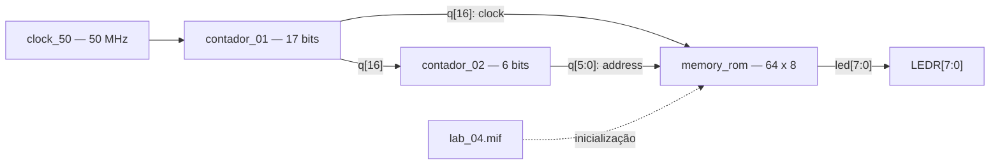

# Texto no Ar — Sistemas Digitais

Experimento acadêmico de **Sistemas Digitais da Universidade Federal de São Carlos (UFSCar)** para geração de padrões luminosos sequenciais nos LEDs da **Terasic DE10-Standard**. Uma ROM armazena as colunas do padrão; contadores estabelecem o intervalo entre elas e o endereço a ser lido.

O princípio didático é a relação entre **sequência temporal de luz e persistência da visão**: com movimento relativo adequado, diferentes instantes podem corresponder a diferentes posições de uma imagem. O circuito eletrônico fornece a sequência; a apresentação espacial depende também das condições da demonstração.

A implementação foi realizada **por diagramas esquemáticos e componentes do ambiente gráfico do Quartus Prime**. Os arquivos `.v` são produtos gerados automaticamente para os IPs; o experimento não foi desenvolvido por programação manual em Verilog.

| Item | Configuração do projeto |
|---|---|
| Placa | Terasic DE10-Standard |
| Dispositivo | Cyclone V **5CSXFC6D6F31C6** |
| Ambiente | **Quartus Prime 23.1**, com suporte a Cyclone V |
| Projeto e revisão | [lab_04.qpf](Texto_Ar/lab_04.qpf), revisão `lab_04` |
| Entidade superior | **`lab_04A`**, definida em [lab_04A.bdf](Texto_Ar/lab_04A.bdf) |
| Entrada | `clock_50`, referência de 50 MHz |
| Saídas efetivas | **`LEDR[7:0]`** |
| Memória | ROM de uma porta, **64 × 8 bits** |

## Objetivos e prática relacionada

O experimento permite estudar a divisão de uma referência de clock, a contagem de endereços, a inicialização de uma ROM e a conversão direta de palavras binárias em estados de LEDs. A observação relaciona os parâmetros digitais ao tempo de cada coluna e ao período de repetição do quadro.

A prática complementar apresenta caracteres em displays de sete segmentos e está disponível em [Texto no Display](https://github.com/sd-ufscar/TEXTO-NO-DISPLAY). Os dois repositórios podem ser obtidos e utilizados independentemente.

## Organização dos arquivos

```text
Texto-no-ar/
├── README.md
├── Texto_Ar/
│   ├── lab_04.qpf / lab_04.qsf / lab_04A.bdf
│   ├── lab_04.bdf / lab_04.mif
│   ├── contador_01.* / contador_02.*
│   └── memory_rom.* / demais arquivos originais
├── lab_04.qip / lab_04.v / lab_04.bsf
├── lab_04_inst.v / lab_04_bb.v / lab_04.mif
├── comprimido/
│   └── lab_04.7z
├── docs/
│   ├── inventario-local.csv
│   ├── validacao.md
│   └── relatorios-originais/
├── .gitattributes
└── .gitignore
```

Os **seis arquivos `lab_04*` na raiz** são cópias idênticas dos arquivos correspondentes de `Texto_Ar/`. Sua função é resolver os caminhos relativos originais: o QSF referencia `../lab_04.qip`, e o IP `memory_rom` referencia `../lab_04.mif`. O QIP superior, por sua vez, relaciona o conjunto gerado `lab_04.v`, `.bsf`, `_inst.v` e `_bb.v` na mesma pasta.

Essa disposição mantém as fontes e suas configurações intactas. Para reproduzir o projeto, obter o **repositório completo**, mantendo também os seis arquivos superiores; copiar apenas `Texto_Ar/` volta a deixar essas referências sem destino.

| Arquivo | Papel |
|---|---|
| [lab_04.qsf](Texto_Ar/lab_04.qsf) | Configuração ativa, dispositivo, fontes e pinos |
| [lab_04A.bdf](Texto_Ar/lab_04A.bdf) | Esquemático selecionado como topo |
| [lab_04.bdf](Texto_Ar/lab_04.bdf) | Outro esquemático preservado; não é o topo da revisão ativa |
| [contador_01.qip](Texto_Ar/contador_01.qip) | Integração do contador de 17 bits |
| [contador_02.qip](Texto_Ar/contador_02.qip) | Integração do contador de endereços de 6 bits |
| [memory_rom.qip](Texto_Ar/memory_rom.qip) | Integração da ROM usada em `lab_04A` |
| [lab_04.mif](Texto_Ar/lab_04.mif) e [espelho superior](lab_04.mif) | As mesmas 64 palavras da memória |
| [lab_04.qip superior](lab_04.qip) | Dependência referenciada pelo QSF original |
| `.bsf`, `.v`, `_bb.v`, `_inst.v`, `.cmp`, `.inc` | Símbolos e arquivos gerados pelos IPs do Quartus |
| [Arquivo_Pinos_DE10_2V5.qsf](Texto_Ar/Arquivo_Pinos_DE10_2V5.qsf) | Modelo geral de pinos, separado da revisão ativa |

O arquivo `lab_04.v` descreve um IP de ROM gerado pelo Quartus. Seu nome não o torna o circuito superior. A revisão ativa define explicitamente **`TOP_LEVEL_ENTITY lab_04A`**. O modelo geral de pinos contém dependências de outro exemplo e não deve ser importado integralmente sobre a revisão fornecida.

## Arquitetura esquemática



O diagrama resume as conexões de [lab_04A.bdf](Texto_Ar/lab_04A.bdf). `contador_01`, instância `inst`, recebe a referência de 50 MHz. Seu bit `q[16]` alimenta o clock de `contador_02`, instância `inst1`, e de `memory_rom`, instância `inst2`. O barramento de saída do segundo contador chega diretamente ao endereço da memória.

A saída `q[7:0]` da ROM recebe o nome de rede `led[7:0]`. Cada bit chega à saída física de mesmo índice em `LEDR`. O terminal `cout` do primeiro contador existe no símbolo, mas não é a fonte do clock reduzido: ele permanece sem conexão no topo.

## Contadores e temporização

O primeiro contador é crescente, possui **17 bits** e conta continuamente. A divisão é obtida pelo bit mais significativo `q[16]`:

```text
f(q[n]) = f_entrada / 2^(n+1)

f(q[16]) = 50.000.000 / 131.072 = 381,4697265625 Hz
T_coluna = 131.072 / 50.000.000 = 0,00262144 s
```

Assim, o segundo contador avança uma vez a cada **2,62144 ms**, em condições ideais. Ele possui seis bits e percorre os endereços de 0 a 63, retornando a zero após 64 passos. Não há módulo reduzido de contagem configurado nos arquivos gerados.

| Intervalo | Cálculo | Valor teórico |
|---|---|---|
| Uma coluna | `2^17 / 50 MHz` | **2,62144 ms** |
| Nove colunas não nulas | `9 × T_coluna` | **23,59296 ms** |
| Cinquenta e cinco colunas apagadas | `55 × T_coluna` | **144,1792 ms** |
| Quadro completo | `64 × T_coluna` | **167,77216 ms** |
| Repetição dos quadros | `1 / T_quadro` | **5,9604644775 Hz** |

Os números são deduções dos parâmetros de contagem e da frequência nominal da referência. Não correspondem a medidas com osciloscópio nem a uma certificação de temporização após compilação. Não há PLL no circuito descrito.

## ROM e padrões luminosos

O IP [memory_rom](Texto_Ar/memory_rom.v) é uma ROM de **64 palavras de 8 bits**, totalizando 512 bits. O endereço possui seis bits, e sua saída é registrada pelo clock (`outdata_reg_a = "CLOCK0"`). A memória e o contador de endereços compartilham a referência reduzida; portanto, deve-se considerar a latência dos registros ao comparar endereço e saída em uma simulação.

O conteúdo efetivo do [MIF](Texto_Ar/lab_04.mif) é:

| Endereço | Palavra `bit7…bit0` | LEDs acesos |
|---|---|---|
| 0 | `00011000` | 3 e 4 |
| 1 e 2 | `00001000` | 3 |
| 3 e 5 | `11101111` | 0, 1, 2, 3, 5, 6 e 7 |
| 4 | `11111111` | 0 a 7 |
| 6 e 7 | `00001000` | 3 |
| 8 | `00001100` | 2 e 3 |
| 9 a 63 | `00000000` | Nenhum |

Cada bit vale 1 quando o LED correspondente deve acender. Essa polaridade é diferente da utilizada nos displays de sete segmentos da outra prática. Não há um decodificador ASCII: as palavras já são as colunas luminosas prontas para apresentação.

Uma leitura espacial dos nove endereços não nulos pode ser representada assim, usando `#` para aceso e `.` para apagado:

```text
endereço →  012345678
LEDR[7]     ...###...
LEDR[6]     ...###...
LEDR[5]     ...###...
LEDR[4]     #...#....
LEDR[3]     #########
LEDR[2]     ...###..#
LEDR[1]     ...###...
LEDR[0]     ...###...
```

Essa matriz é uma interpretação didática do arquivo de memória, com o índice do LED no eixo vertical. Não é uma fotografia nem uma indicação da orientação física da placa. O conjunto contém um padrão de nove colunas, seguido de 55 palavras apagadas; não há evidência suficiente para atribuir uma frase ou um alfabeto completo a esse conteúdo.

## Relação com a visualização no ar

Com os LEDs parados, os padrões ocupam as mesmas posições físicas em instantes diferentes. Para formar uma figura espacial, o movimento relativo entre a fileira de LEDs e a observação precisa converter o tempo em deslocamento transversal à fileira. Se a velocidade relativa for aproximadamente constante e igual a `v`, o espaçamento entre colunas será aproximadamente:

```text
Δx = v × T_coluna
```

Aumentar a velocidade física aumenta o espaçamento; irregularidades no movimento deformam a figura. O trecho apagado pode separar as repetições, mas não fornece, por si só, sincronização mecânica.

O topo possui somente a entrada de clock. Não existem entradas de sensor de posição, referência de início de curso, botão de disparo ou detecção do sentido do movimento. A sequência se repete livremente. Portanto, a geração das colunas pela FPGA e a obtenção de uma imagem legível são etapas distintas da demonstração.

## Pinos utilizados

| Sinal | Pino do Cyclone V | Função |
|---|---|---|
| `clock_50` | `AF14` | Referência de 50 MHz |
| `LEDR[0]` | `AA24` | Bit 0 da palavra |
| `LEDR[1]` | `AB23` | Bit 1 |
| `LEDR[2]` | `AC23` | Bit 2 |
| `LEDR[3]` | `AD24` | Bit 3 |
| `LEDR[4]` | `AG25` | Bit 4 |
| `LEDR[5]` | `AF25` | Bit 5 |
| `LEDR[6]` | `AE24` | Bit 6 |
| `LEDR[7]` | `AF24` | Bit 7 |

`LEDR[8]` e `LEDR[9]` não são saídas deste topo. As chaves e botões não controlam a experiência, mesmo que seus nomes constem nas atribuições gerais da placa. As especificações da [DE10-Standard](https://www.terasic.com.tw/cgi-bin/page/archive.pl?No=1081&PartNo=2) e o [manual da Terasic, seção 3.6.1](https://www.mouser.com/datasheet/3/996/1/DE10-Standard_User_manual.pdf) apresentam a plataforma e o banco de LEDs.

## Abrir, compilar e programar

1. Instalar **Quartus Prime 23.1**, suporte à família Cyclone V e driver do **USB-Blaster II**. Os arquivos registram `23.1std.0 Build 991`, edição Lite.
2. Clonar o repositório completo:

   ```sh
   git clone https://github.com/sd-ufscar/Texto-no-ar.git
   cd Texto-no-ar
   ```

3. Manter a estrutura da raiz, incluindo os seis arquivos de dependência espelhados. Abrir **File → Open Project → Texto_Ar/lab_04.qpf**.
4. Conferir a revisão `lab_04`, o dispositivo **5CSXFC6D6F31C6** e o topo **`lab_04A`**. Não substituir o topo por `lab_04` apenas por coincidir com o nome do projeto.
5. Em **Project → Add/Remove Files in Project**, conferir `lab_04A.bdf`, os IPs de `contador_01`, `contador_02`, `memory_rom`, o QIP superior e `lab_04.mif`. Os QIPs devem conservar suas referências aos arquivos gerados.
6. Abrir o BDF e conferir `q[16]` como clock reduzido e as oito conexões entre a ROM e os LEDs. Inspecionar os parâmetros dos IPs sem regenerá-los com valores diferentes.
7. No **Pin Planner**, conferir os nove sinais da tabela. Os relatórios de referência registram padrão de I/O de 2,5 V; conferir a adequação elétrica com o manual e a placa antes da programação. A configuração original permanece preservada.
8. Selecionar **Processing → Start Compilation** e conferir cada etapa e seus avisos. O arquivo esperado após uma compilação concluída é `Texto_Ar/output_files/lab_04.sof`.
9. Conectar o computador ao **USB-Blaster II** da DE10-Standard e alimentar a placa conforme o manual. Abrir **Tools → Programmer**, selecionar o cabo em **Hardware Setup** e usar modo **JTAG**.
10. Utilizar **Auto Detect** quando necessário. Associar o `.sof` recém-gerado ao dispositivo FPGA adequado, marcar **Program/Configure** e selecionar **Start**. Respeitar os demais dispositivos que possam aparecer na cadeia, inclusive o HPS.
11. Conferir a conclusão da programação. A sequência nos LEDs começa a ser produzida pela configuração; não há um botão de início implementado pelo topo.

O comando equivalente de compilação, executado dentro de `Texto_Ar/`, é:

```sh
quartus_sh --flow compile lab_04
```

O `.sof` por JTAG configura a FPGA de forma volátil. Não é necessário programar memória de configuração persistente para a prática descrita. Os binários antigos do diretório de compilação não são apresentados como resultados de uma nova compilação desta publicação.
